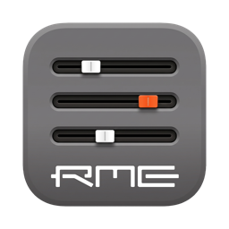

# RME Control



A macOS menu bar app that controls **RME TotalMix FX** over OSC: output volume, Dim / Mono /
Speaker B, +48V and Inst on inputs, level meters, and a web remote for your phone.

[Русская версия](README.md) · [MIT License](LICENSE)


## Features

- **Menu bar popover** — output faders with dB readout, Mute, and the Control Room buttons
  (Dim, Mono, Speaker B), plus +48V and Inst switches for inputs.
- **Hardware volume keys** — the keyboard's volume and mute keys drive TotalMix instead of
  the system volume, and any action can be bound to a custom shortcut.
- **Web remote** — a built-in HTTP server serves a control page for a phone in the same
  network, reachable by scanning a QR code from the settings.
- **Level meters** — input and output levels, with a clipping warning.
- **Compressor and EQ panels** — the Dynamics and EQ sections of TotalMix in their own windows.
- **Channel discovery** — scans TotalMix for inputs, outputs and sends and lets you name them.
- **HUD and notifications** — a short overlay shows volume and status changes; the app notifies
  you when the interface connects or disconnects.
- **Presets** — save and restore channel configurations.
- **14 UI languages** — English, Russian, German, French, Spanish, Italian, Portuguese, Dutch,
  Polish, Ukrainian, Turkish, Chinese (Simplified), Japanese, Korean.
- **OSC monitor** — a live log of outgoing and incoming OSC messages for troubleshooting.
- Launch at login, connection monitoring, ad-hoc signed universal binary (Apple Silicon + Intel).

## Requirements

- macOS 14 Sonoma or newer (Apple Silicon or Intel).
- To build: **Xcode Command Line Tools** (Swift 6.0+) — the full Xcode is only needed to run
  the test suite, or to build from the Xcode project.

## Build and install

```bash
xcode-select --install      # once, if the command line tools are missing
cd rme-control
./build.sh --install
```

`build.sh` compiles both architectures (this takes a few minutes and prints nothing while the
compiler works), copies resources and translations, ad-hoc signs the bundle and installs
`/Applications/RME Control.app`. Progress is reported as `[1/5]` … `[5/5]`.

| Command | Result |
|---|---|
| `./build.sh` | `build/Release/RME Control.app` in the project folder |
| `./build.sh --install` | builds, copies to `/Applications` and launches |
| `./build.sh --zip` | builds and packs `build/RME-Control-<version>.zip` for sharing |
| `./make-installer.sh` | builds a `.pkg` installer from an already built app |

The version comes from `MARKETING_VERSION` in the Xcode project, so it is set in one place.

### Xcode

Open `RME Control.xcodeproj` and press ⌘R. For a standalone `.app`: Product → Archive →
Distribute App → Custom → Copy App.

## Configuration

1. Enable OSC in TotalMix FX: **Options → Settings → OSC**, and note the ports.
2. Open the app's **Settings → Connection** and set the matching send/receive ports
   (default host is `127.0.0.1`).
3. Run the setup assistant on first launch, or re-run it from **Settings → General →
   Run Setup Assistant**, to discover channels and grant permissions.

To make the volume keys work, allow the app in **System Settings → Privacy & Security →
Accessibility**. The permission is tied to the code signature, so after rebuilding it has to be
revoked and granted again.

The interface language is chosen in **Settings → General → Interface**; the app has to be
restarted afterwards.

## Project structure

```
RME Control/
├── App/          app entry point, AppDelegate, status bar item, window manager
├── Common/       reusable views, window chrome, fader math, QR code generation
├── Features/     popover, HUD, levels, compressor, EQ, settings, setup assistant
├── Models/       channel configs, hotkeys, presets, language
├── Resources/    Localizable.xcstrings, icons, web remote HTML/JS
└── Services/
    ├── Mixer/    MixerService, MixerState, channel scanner, connection monitor
    ├── OSC/      OSC codec, client, addresses, monitor
    ├── Settings/ AppSettings and defaults
    ├── Storage/  settings file, UserDefaults storage, migration
    ├── System/   accessibility, launch at login, network info, volume keys
    └── WebServer/ built-in HTTP server and JSON API for the web remote
RMEControlTests/  unit and integration tests
installer/        preinstall and postinstall scripts for the .pkg
```

The UI is SwiftUI with the Observation framework, and the sources are compiled straight from
the source tree by `build.sh` — there are no external package dependencies. The web remote uses
a bundled copy of React (MIT, see the license header in the file).

## Tests

The test target needs the full Xcode:

```bash
xcodebuild test -project "RME Control.xcodeproj" -scheme "RME Control" -destination 'platform=macOS'
```

## Distribution notes

The app is signed ad-hoc and not notarized, so macOS blocks it on another machine after
downloading. Build it locally on the target machine, or clear the quarantine flag:

```bash
xattr -dr com.apple.quarantine "/Applications/RME Control.app"
```

A `.pkg` built by `make-installer.sh` clears the quarantine in its postinstall script; a fully
warning-free distribution requires a paid Apple Developer ID (see the comments in that script).

## License

[MIT](LICENSE).

RME, TotalMix and the RME logo are trademarks of RME Audio AG. This project is an independent
tool and is not affiliated with, endorsed by, or supported by RME Audio.
