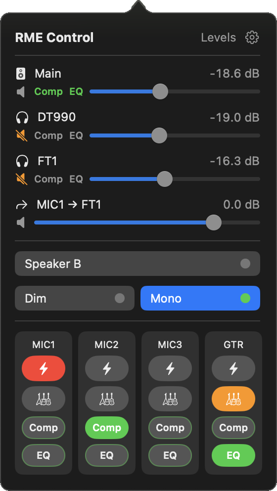
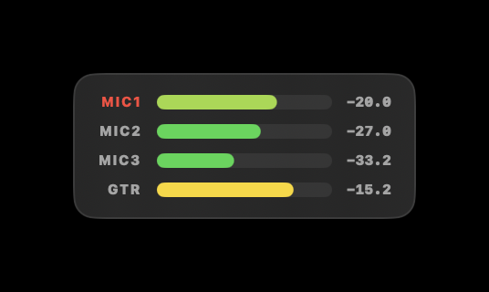
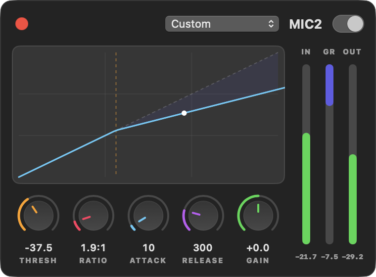
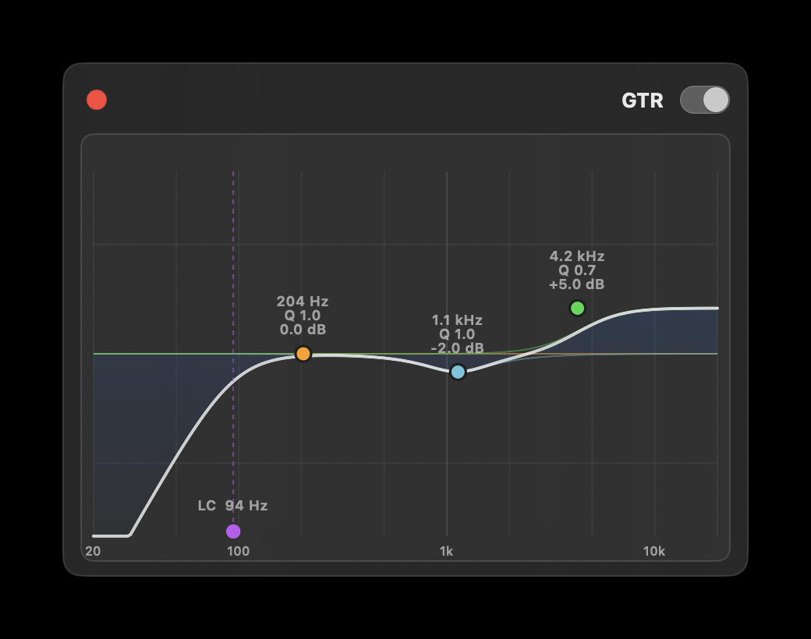

# RME Control


A macOS menu bar app that controls **RME TotalMix FX** over OSC: output volume, Dim / Mono /
Speaker B, +48V and Inst on inputs, level meters, and a web remote for your phone.

[Русская версия](README.ru.md) · [MIT License](LICENSE) · [Changelog](CHANGELOG.md)


## Screenshots

<p align="center">
  
  
</p>
<p align="center"><sub>Popover · input levels</sub></p>

<p align="center">
  
  
</p>
<p align="center"><sub>Compressor and equalizer</sub></p>

## Features

### Audio outputs — control and monitoring

- Volume control for any output (including Main Out and headphones) from the Mac volume
  keys or the menu bar.
- Adjustable volume step from 1 to 10 dB.
- Dim / Mute on the Mac mute key.
- Mono switch on a global shortcut (Shift + Cmd + M by default).
- Speaker B button to switch to an alternative pair of monitors.
- A shortcut switches which output the volume keys control (Option + ↑/↓ by default).
- Channel editing: modify existing inputs and outputs or add new ones.
- Sends from input channels to output channels.

### Inputs

- Phantom power (+48V) for any number of input channels.
- Instrument mode (Inst) for any number of input channels.
- Convenient EQ and compressor control.

### Interface, notifications and customization

- Dedicated always-on-top window for input level monitoring.
- Clipping notifications to prevent signal overload.
- On-screen notifications for volume, Dim, Mono and Mute — also when the values are changed
  directly in TotalMix; the Mute notification shows the output name.
- Customizable application menu.
- Every keyboard shortcut is assignable — the defaults are just a starting point.
- Presets to save and restore all application settings.

### TotalMix integration and synchronization

- Full two-way synchronization: the app reads the values from TotalMix at startup and keeps
  a stable connection.
- Fail-safe disconnection: values freeze and the Mac volume keys return to native system
  behavior when TotalMix or the audio interface goes away.
- OSC monitor in the Connection section to watch the network commands.

### Remote control

- Built-in web server, started with a single “HTTP server” toggle in the settings.
- QR code connection: scan it with a phone or tablet on the same Wi-Fi network and a full
  RME remote control opens in the mobile browser.

## Requirements

- macOS 14 Sonoma or newer (Apple Silicon or Intel).
- To build: **Xcode Command Line Tools** (Swift 6.0+) — the full Xcode is only needed to run
  the test suite, or to build from the Xcode project.

## Build and install

```bash
xcode-select --install      # once, if the command line tools are missing
cd rme-control
./build.sh --install
```

`build.sh` compiles both architectures (this takes a few minutes and prints nothing while the
compiler works), copies resources and translations, ad-hoc signs the bundle and installs
`/Applications/RME Control.app`. Progress is reported as `[1/5]` … `[5/5]`.

| Command | Result |
|---|---|
| `./build.sh` | `build/Release/RME Control.app` in the project folder |
| `./build.sh --install` | builds, copies to `/Applications` and launches |
| `./build.sh --zip` | builds and packs `build/RME-Control-<version>.zip` for sharing |
| `./make-installer.sh` | builds a `.pkg` installer from an already built app |

The version comes from `MARKETING_VERSION` in the Xcode project, so it is set in one place.

### Xcode

Open `RME Control.xcodeproj` and press ⌘R. For a standalone `.app`: Product → Archive →
Distribute App → Custom → Copy App.

## Configuration

1. Enable OSC in TotalMix FX: **Options → Settings → OSC**, and note the ports.
2. Open the app's **Settings → Connection** and set the matching send/receive ports
   (default host is `127.0.0.1`).
3. Run the setup assistant on first launch, or re-run it from **Settings → General →
   Run Setup Assistant**, to discover channels and grant permissions.

To make the volume keys work, allow the app in **System Settings → Privacy & Security →
Accessibility**. The permission is tied to the code signature, so after rebuilding it has to be
revoked and granted again.

The interface language is chosen in **Settings → General → Interface**; the app has to be
restarted afterwards.

## Troubleshooting

### Build errors

A failed run ends with `BUILD FAILED` and the compiler output above that line.

| What you see | What to do |
|---|---|
| `permission denied: ./build.sh` | `chmod +x build.sh`, then run it again |
| `no such file or directory: ./build.sh` | You are not in the project folder — `cd` into it first |
| `swiftc not found` or `xcrun: error: invalid active developer path` | Install the Command Line Tools: `xcode-select --install` |
| `error: ... swift-version 6`, errors about `Observation` or `@Observable` | Swift is older than 6.0 — update the Command Line Tools |
| `xcrun: error: unable to find utility "swiftc"` while Xcode is installed | `sudo xcode-select --switch /Library/Developer/CommandLineTools` |

### The app does not start

- **“Damaged” or “cannot be verified”** — clear the quarantine flag, see
  [Distribution notes](#distribution-notes).
- **Nothing happens and there is no icon in the menu bar** — check that the Mac runs macOS 14 or
  newer. An `.app` that was transferred outside a `.zip` can lose its executable bit: rebuild it,
  or ask for the `.zip`.
- **The volume keys do nothing** — grant Accessibility in System Settings → Privacy & Security →
  Accessibility → RME Control. The code signature changes with every rebuild, so the old
  permission has to be removed and granted again, then restart the app.
- **No connection to TotalMix** — enable OSC in TotalMix FX (Options → Settings → OSC) and make
  sure the ports match the ones in RME Control (**Settings → Connection**).

## Project structure

```
RME Control/
├── App/          app entry point, AppDelegate, status bar item, window manager
├── Common/       reusable views, window chrome, fader math, QR code generation
├── Features/     popover, HUD, levels, compressor, EQ, settings, setup assistant
├── Models/       channel configs, hotkeys, presets, language
├── Resources/    Localizable.xcstrings, icons, web remote HTML/JS
└── Services/
    ├── Mixer/    MixerService, MixerState, channel scanner, connection monitor
    ├── OSC/      OSC codec, client, addresses, monitor
    ├── Settings/ AppSettings and defaults
    ├── Storage/  settings file, UserDefaults storage, migration
    ├── System/   accessibility, launch at login, network info, volume keys
    └── WebServer/ built-in HTTP server and JSON API for the web remote
RMEControlTests/  unit and integration tests
installer/        preinstall and postinstall scripts for the .pkg
```

The UI is SwiftUI with the Observation framework, and the sources are compiled straight from
the source tree by `build.sh` — there are no external package dependencies. The web remote uses
a bundled copy of React (MIT, see the license header in the file).

## Tests

The test target needs the full Xcode:

```bash
xcodebuild test -project "RME Control.xcodeproj" -scheme "RME Control" -destination 'platform=macOS'
```

## Distribution notes

The app is signed ad-hoc and not notarized, so macOS blocks it on another machine after
downloading. Build it locally on the target machine, or clear the quarantine flag:

```bash
xattr -dr com.apple.quarantine "/Applications/RME Control.app"
```

A `.pkg` built by `make-installer.sh` clears the quarantine in its postinstall script; a fully
warning-free distribution requires a paid Apple Developer ID (see the comments in that script).

## License

[MIT](LICENSE).

RME, TotalMix and the RME logo are trademarks of RME Audio AG. This project is an independent
tool and is not affiliated with, endorsed by, or supported by RME Audio.
