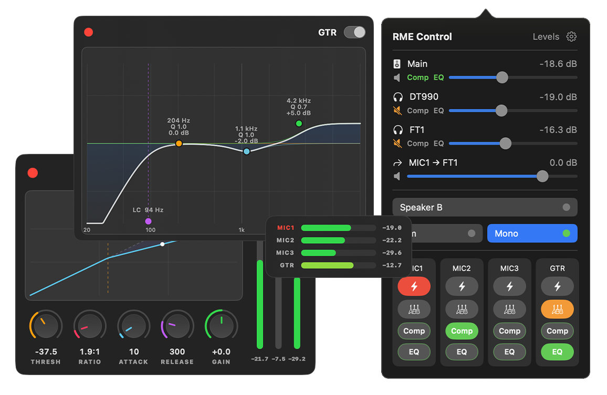
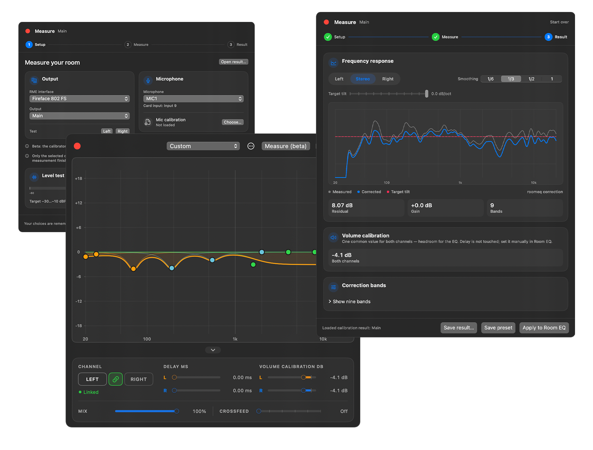

<p align="center">
  
</p>

# RME Control

RME Control is a free, open-source macOS utility that controls the TotalMix FX mixer for RME audio interfaces straight from the Mac menu bar. It saves you from opening the main app window for everyday settings.

Works via Global OSC only with TotalMix 2.1+.

[Website](https://repentov-dev.github.io/rme-control/) · [MIT License](LICENSE) · [Instagram](https://www.instagram.com/repentov)


## Key features

- **Outputs and processing** — volume and quick output switching from the Mac keyboard, Mute, Dim and Mono, plus the compressor and 3-band EQ on output channels.
- **Room EQ and room calibration** — a full port of Room EQ from TotalMix for every output, with delay and Crossfeed, plus a room calibration wizard that supports measurement microphone calibration files.
- **Headphone presets** — a built-in library of EQ curves for 80 headphone models across 25 popular brands.
- **Inputs** — quick access to +48V phantom power, Instrument mode (Inst), EQ and compressor on input channels.
- **More** — always-on-top level meters, custom presets, customizable keyboard shortcuts and web-based remote control from a phone.

## What's new in 4.0

1. **Room EQ fully carried over from TotalMix.** Nine bands per output, and the **Mix** and **Crossfeed** controls now live right inside the Room EQ window.
2. **A large library of presets for the most popular headphones.** 25 brands, 80 models.
3. **Correction system.** Measure both speakers, get left, right and stereo corrections and apply them to Room EQ. Save your own calibration presets; microphone calibration files are supported.

Beta: the calibrator was tested on the Fireface 802 FS and may behave differently on other interfaces.

<p align="center">
  
</p>

## Requirements

- macOS 14 Sonoma or newer (Apple Silicon or Intel).
- To build: **Xcode Command Line Tools** (Swift 6.0+) — the full Xcode is only needed to run
  the test suite, or to build from the Xcode project.

## Build and install

```bash
xcode-select --install      # once, if the command line tools are missing
cd rme-control
./build.sh --install
```

`build.sh` compiles both architectures (this takes a few minutes and prints nothing while the
compiler works), copies resources and translations, ad-hoc signs the bundle and installs
`/Applications/RME Control.app`. Progress is reported as `[1/5]` … `[5/5]`.

| Command | Result |
|---|---|
| `./build.sh` | `build/Release/RME Control.app` in the project folder |
| `./build.sh --install` | builds, copies to `/Applications` and launches |
| `./build.sh --zip` | builds and packs `build/RME-Control-<version>.zip` for sharing |
| `./make-installer.sh` | builds a `.pkg` installer from an already built app |

The version comes from `MARKETING_VERSION` in the Xcode project, so it is set in one place.

### Xcode

Open `RME Control.xcodeproj` and press ⌘R. For a standalone `.app`: Product → Archive →
Distribute App → Custom → Copy App.

## Configuration

### TotalMix

The app talks Global OSC and listens on fixed ports. In TotalMix FX 2.1 or newer:

1. Set the OSC **host** to `127.0.0.1` and the **ports** to `7001` and `9001`.
2. Open **Options → Mixer Settings → OSC** and set **Compatibility (Mode)** to **Global OSC**.
3. Turn on **Send Status**.
4. Turn on **Send level data**.
5. Turn on **Peak hold**.
6. Turn on **Send all data on start**.

### The app

1. Open **Settings → Connection** and set the same send and receive ports.
2. Run the setup assistant on first launch, or re-run it from **Settings → General →
   Run Setup Assistant**, to discover channels and grant permissions.

To make the volume keys work, allow the app in **System Settings → Privacy & Security →
Accessibility**. The permission is tied to the code signature, so after rebuilding it has to be
revoked and granted again.

The interface is available in 14 languages and is chosen in **Settings → General → Interface**;
the app has to be restarted afterwards.

## Troubleshooting

### Build errors

A failed run ends with `BUILD FAILED` and the compiler output above that line.

| What you see | What to do |
|---|---|
| `permission denied: ./build.sh` | `chmod +x build.sh`, then run it again |
| `no such file or directory: ./build.sh` | You are not in the project folder — `cd` into it first |
| `swiftc not found` or `xcrun: error: invalid active developer path` | Install the Command Line Tools: `xcode-select --install` |
| `error: ... swift-version 6`, errors about `Observation` or `@Observable` | Swift is older than 6.0 — update the Command Line Tools |
| `xcrun: error: unable to find utility "swiftc"` while Xcode is installed | `sudo xcode-select --switch /Library/Developer/CommandLineTools` |

### The app does not start

- **“Damaged” or “cannot be verified”** — clear the quarantine flag, see
  [Distribution notes](#distribution-notes).
- **Nothing happens and there is no icon in the menu bar** — check that the Mac runs macOS 14 or
  newer. An `.app` that was transferred outside a `.zip` can lose its executable bit: rebuild it,
  or ask for the `.zip`.
- **The volume keys do nothing** — grant Accessibility in System Settings → Privacy & Security →
  Accessibility → RME Control. The code signature changes with every rebuild, so the old
  permission has to be removed and granted again, then restart the app.
- **No connection to TotalMix** — enable OSC in TotalMix FX (Options → Settings → OSC) and make
  sure the ports match the ones in RME Control (**Settings → Connection**).

## Project structure

```
RME Control/
├── App/          app entry point, AppDelegate, status bar item, window manager
├── Common/       reusable views, window chrome, fader math, QR code generation
├── Features/     popover, HUD, levels, compressor, EQ, settings, setup assistant
├── Models/       channel configs, hotkeys, presets, language
├── Resources/    Localizable.xcstrings, icons, web remote HTML/JS
└── Services/
    ├── Mixer/    MixerService, MixerState, channel scanner, connection monitor
    ├── OSC/      OSC codec, client, addresses, monitor
    ├── Settings/ AppSettings and defaults
    ├── Storage/  settings file, UserDefaults storage, migration
    ├── System/   accessibility, launch at login, network info, volume keys
    └── WebServer/ built-in HTTP server and JSON API for the web remote
RMEControlTests/  unit and integration tests
installer/        preinstall and postinstall scripts for the .pkg
```

The UI is SwiftUI with the Observation framework, and the sources are compiled straight from
the source tree by `build.sh` — there are no external package dependencies. The web remote uses
a bundled copy of React (MIT, see the license header in the file).

## Tests

The test target needs the full Xcode:

```bash
xcodebuild test -project "RME Control.xcodeproj" -scheme "RME Control" -destination 'platform=macOS'
```

## Distribution notes

The app is signed ad-hoc and not notarized, so macOS blocks it on another machine after
downloading. Build it locally on the target machine, or clear the quarantine flag:

```bash
xattr -dr com.apple.quarantine "/Applications/RME Control.app"
```

A `.pkg` built by `make-installer.sh` clears the quarantine in its postinstall script; a fully
warning-free distribution requires a paid Apple Developer ID (see the comments in that script).

## Acknowledgements

- Room EQ optimisation: [roomeq](https://github.com/pierreaubert/autoeq) (GPL-3.0), continuing [AutoEQ](https://github.com/jaakkopasanen/AutoEq) by Jaakko Pasanen.
- Sweep measurement: [sotf-capture](https://github.com/pierreaubert/sotf-capture) (GPL-3.0).
- Headphone presets: based on [AutoEQ](https://github.com/jaakkopasanen/AutoEq) data (MIT) and measurements by oratory1990, Crinacle and Rtings.

## License

[MIT](LICENSE).

RME, TotalMix and the RME logo are trademarks of RME Audio AG. This project is an independent
tool and is not affiliated with, endorsed by, or supported by RME Audio.
