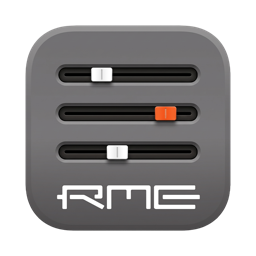
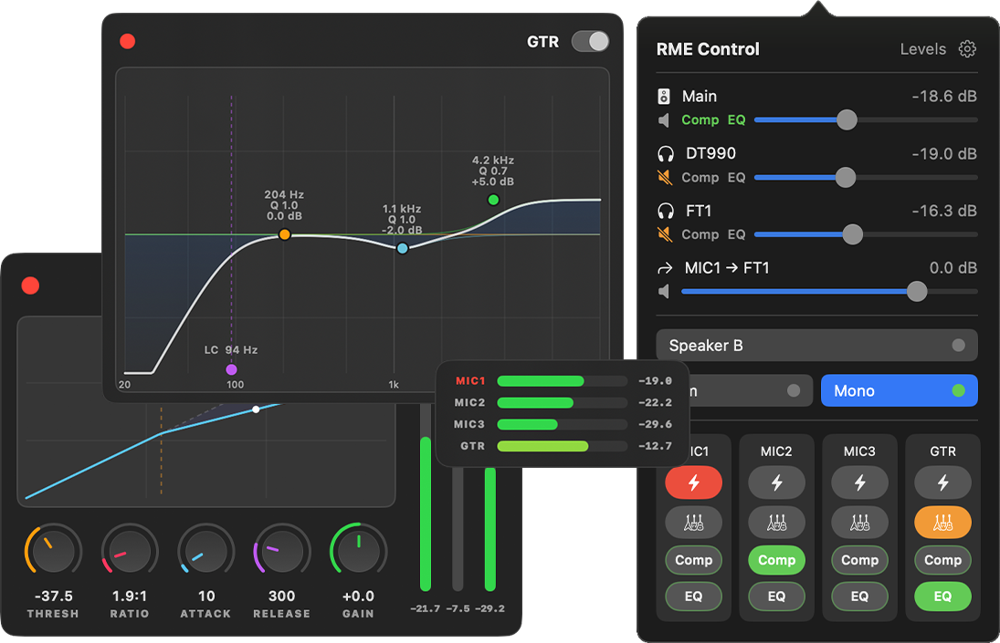

# RME Control



Приложение в строке меню с открытым исходным кодом для управления аудиоинтерфейсами RME
через **TotalMix FX**.

Работает только через Global OSC и только с TotalMix 2.1+.

[Сайт](https://repentov-dev.github.io/rme-control/) · [English version](README.md) · [Лицензия MIT](LICENSE) · [Instagram](https://www.instagram.com/repentov)


- macOS 14 Sonoma и новее
- Apple Silicon и Intel (сборка универсальная)
- Исходный код на SwiftUI без внешних зависимостей, 14 языков интерфейса

## Возможности

### Выходы — управление и мониторинг

- Громкость любых выходов (включая Main Out и наушники) — с клавиш Mac или из строки меню.
- Настраиваемый шаг громкости от 1 до 10 дБ.
- Dim / Mute на клавише Mute.
- Переключение Mono на глобальном шорткате (по умолчанию Shift + Cmd + M).
- Кнопка Speaker B для перехода на альтернативную пару мониторов.
- Шорткат переключает выход, которым управляют клавиши громкости (по умолчанию Option + ↑/↓).
- Редактирование каналов: изменение существующих входов и выходов и добавление новых.
- Посылы (sends) со входов на выходы.

### Входы

- Фантомное питание (+48V) для любого числа входов.
- Режим инструмента (Inst) для любого числа входов.
- Удобное управление EQ и компрессором.

### Интерфейс, уведомления и настройка

- Отдельное окно поверх всех окон для мониторинга уровней входов.
- Уведомления о клиппинге — защита от перегрузки сигнала.
- Экранные уведомления об изменении громкости, Dim, Mono и Mute, в том числе когда значения
  меняют прямо в TotalMix; уведомление Mute показывает имя выхода.
- Настраиваемое меню приложения.
- Любую горячую клавишу можно переназначить — значения по умолчанию это только отправная точка.
- Пресеты для сохранения и восстановления всех настроек приложения.

### Интеграция с TotalMix и синхронизация

- Полная двусторонняя синхронизация: приложение читает значения из TotalMix при запуске
  и поддерживает стабильное соединение.
- Безопасный обрыв связи: значения замораживаются, а клавиши громкости возвращаются
  к системному поведению, если TotalMix или аудиоинтерфейс отключились.
- Монитор OSC в разделе Connection для отслеживания сетевых команд.

### Управление с телефона

- Встроенный веб-сервер, запускается одним переключателем «HTTP server» в настройках.
- Подключение по QR-коду: отсканируйте его телефоном или планшетом в той же Wi-Fi сети,
  и в браузере откроется полный пульт RME.

## Скриншоты

<p align="center">
  
</p>

## Сборка без Xcode — пошагово

Полный Xcode не нужен, достаточно **Xcode Command Line Tools**. Все команды ниже
вводятся в приложении **Терминал** (Программы → Утилиты → Терминал, или ⌘Пробел → «Терминал»).
Каждую команду вставьте целиком и нажмите Enter.

### Шаг 1. Установить Command Line Tools (один раз)

```bash
xcode-select --install
```

Откроется окно установки, нажмите «Установить» и дождитесь конца (5–15 минут).
Если в ответ пишет `command line tools are already installed`, значит, они уже есть.

Проверьте версию Swift:

```bash
swiftc --version
```

Должно быть **Swift version 6.0** или новее. Если версия 5.x, обновите Command Line Tools:
System Settings → General → Software Update, или скачайте их с
[developer.apple.com/download/all](https://developer.apple.com/download/all/) (вход по Apple ID).

### Шаг 2. Перейти в папку проекта

Напечатайте `cd ` (с пробелом в конце), затем **перетащите папку проекта из Finder в окно
Терминала**, путь подставится сам. Нажмите Enter. Должно получиться примерно так:

```bash
cd /Users/имя/Downloads/rmecontrol
```

Проверка: команда `ls` должна показать `build.sh`, `README.md` и папку `RME Control`.

### Шаг 3. Собрать и установить

```bash
./build.sh --install
```

Скрипт пишет, что делает, шагами `[1/5]` … `[5/5]`:

```
==> [1/5] Checking tools
==> [2/5] Compiling (2 passes: Apple Silicon and Intel). This takes 1-5 minutes and prints nothing - it is not frozen.
    compiling arm64 ...
    compiling x86_64 ...
==> [3/5] Copying resources and translations
==> [4/5] Signing (ad-hoc)
==> [5/5] Done
    Installed: /Applications/RME Control.app
```

**На шаге 2 несколько минут ничего не происходит, это нормально**: компилятор работает молча.
Не закрывайте Терминал и не нажимайте Ctrl+C, дождитесь `[5/5] Done`.

После этого приложение копируется в «Программы» и запускается. Его значок появится
в строке меню справа вверху, отдельного окна нет.

### Шаг 4. Первый запуск и разрешения

При первом запуске открывается мастер настройки: он находит входы и выходы
в TotalMix FX (пока их нет, в панели из строки меню будет предложено выполнить
сканирование), проверяет разрешения и предлагает запуск при входе в систему.
Мастер можно закрыть и вернуться к нему позже: Настройки → General → Run Setup Assistant.

Чтобы работали клавиши громкости на клавиатуре, приложение попросит разрешение
«Специальные возможности»: System Settings → Privacy & Security → Accessibility →
включите RME Control, затем перезапустите приложение.

### Варианты запуска скрипта

| Команда | Что делает |
|---|---|
| `./build.sh` | Только собирает `build/Release/RME Control.app` в папке проекта |
| `./build.sh --install` | Собирает, копирует в «Программы» и запускает |
| `./build.sh --zip` | Собирает и упаковывает в `build/RME-Control-<версия>.zip` для отправки |

### Ошибки при сборке

Если что-то пошло не так, в конце будет строка `BUILD FAILED`, а выше — текст ошибки.

| Что видно | Что делать |
|---|---|
| `permission denied: ./build.sh` | Выполнить `chmod +x build.sh` и запустить снова |
| `no such file or directory: ./build.sh` | Вы не в папке проекта, повторите шаг 2 |
| `swiftc not found` или `xcrun: error: invalid active developer path` | Установить Command Line Tools, шаг 1 |
| `error: ... swift-version 6` / ошибки про `Observation`, `@Observable` | Старый Swift, нужен 6.0+, см. шаг 1 |
| `xcrun: error: unable to find utility "swiftc"` при установленном Xcode | `sudo xcode-select --switch /Library/Developer/CommandLineTools` |

Если ошибка другая, пришлите разработчику весь вывод Терминала, начиная с команды `./build.sh`.

## Сборка в Xcode

Откройте `RME Control.xcodeproj` и нажмите Run (⌘R). Для отдельного `.app`:
Product → Archive → Distribute App → Custom → Copy App.

## Как отправить приложение другому человеку

Приложение подписано **без** Apple Developer ID и не нотаризовано (это платная
программа Apple за $99 в год). Поэтому на чужом Mac macOS блокирует его после
скачивания: появляется «приложение повреждено», «не удаётся проверить разработчика»
или оно просто не открывается. Это не зависит от способа сборки: так же ведёт себя
и `.app` из Xcode Archive.

Есть три варианта.

**1. Получатель собирает сам (надёжнее всего).** Отправьте папку проекта, получатель
запускает `./build.sh --install`. Приложение, собранное на своём Mac, macOS не блокирует.

**2. Отправить готовое приложение.** Упакуйте его через `./build.sh --zip` и отправьте
`.zip`, а не `.app` (мессенджеры и облака часто портят бандл `.app`). Получателю нужно:

1. Распаковать архив и перенести `RME Control.app` в «Программы».
2. Снять карантин в Терминале:
   ```bash
   xattr -dr com.apple.quarantine "/Applications/RME Control.app"
   ```
   Или: попытаться открыть приложение, затем System Settings → Privacy & Security →
   внизу «RME Control was blocked…» → **Open Anyway**.

**3. Установщик `.pkg` (сам снимает карантин с приложения).**
Соберите его командой `./make-installer.sh` — получится `build/RME-Control-<версия>.pkg`.
Установщик закрывает запущенную копию, кладёт приложение в «Программы» и в
postinstall-скрипте выполняет `xattr -dr com.apple.quarantine` для установленного
бандла. После установки приложение запускается без предупреждений.

Важно: сам `.pkg` тоже скачивается с карантином, и без подписи Apple его первый
запуск macOS заблокирует так же: разрешите его один раз в System Settings →
Privacy & Security → **Open Anyway**. Полностью без предупреждений работает только
подписанный и нотаризованный установщик (Developer ID Application + Developer ID
Installer, $99/год): `make-installer.sh` умеет это, если задать `APP_IDENTITY`,
`INSTALLER_IDENTITY` и `NOTARY_PROFILE`.

Без Apple Developer ID нулевое предупреждение даёт раздача не через браузер, а
через `curl` или Homebrew: `curl` не ставит карантин, поэтому скачанный так `.pkg`
(или `.zip`) устанавливается без Gatekeeper-предупреждений.

## Если приложение не запускается

- **«Повреждено» / «не удаётся проверить»**: снимите карантин, см. выше.
- **Ничего не происходит, нет значка в строке меню**: проверьте версию macOS (нужна 14+).
  Если `.app` пришёл не в `.zip`, у файла могли пропасть права на запуск.
  Пересоберите приложение или попросите прислать `.zip`.
- **Клавиши громкости не работают**: выдайте разрешение System Settings →
  Privacy & Security → Accessibility → RME Control. После каждой пересборки подпись
  меняется, поэтому разрешение нужно удалить и выдать заново, затем перезапустить приложение.
- **Нет связи с TotalMix**: включите OSC в настройках TotalMix FX (Options → Settings,
  вкладка OSC). Порты там должны совпадать с портами в RME Control (раздел **Connection**).

## Настройка TotalMix

Приложение работает через Global OSC и слушает фиксированные порты. В TotalMix FX 2.1 или новее:

1. **Host** — `127.0.0.1`, **порты** — `7001` и `9001`.
2. **Options → Mixer Settings → OSC**, затем **Compatibility (Mode)** → **Global OSC**.
3. Включите **Send Status**.
4. Включите **Send level data**.
5. Включите **Peak hold**.
6. Включите **Send all data on start**.

Дальше в приложении: **Settings → Connection** — те же порты. Мастер настройки при первом
запуске (или **Settings → General → Run Setup Assistant**) найдёт каналы и попросит разрешения.

## Язык интерфейса

English по умолчанию. Русский включается в настройках (раздел **General** → **Interface**),
после выбора приложение нужно перезапустить (кнопка Restart now).

## Структура проекта

```
RME Control/
├── App/          точка входа, AppDelegate, значок в строке меню, менеджер окон
├── Common/       общие вью, оформление окон, математика фейдера, QR-код
├── Features/     поповер, HUD, уровни, компрессор, эквалайзер, настройки, мастер настройки
├── Models/       конфиги каналов, хоткеи, пресеты, языки
├── Resources/    Localizable.xcstrings, иконки, веб-пульт (HTML/JS)
└── Services/
    ├── Mixer/    MixerService, MixerState, сканер каналов, монитор соединения
    ├── OSC/      кодек OSC, клиент, адреса, монитор
    ├── Settings/ AppSettings и значения по умолчанию
    ├── Storage/  файл настроек, UserDefaults, миграция
    ├── System/   специальные возможности, автозапуск, сеть, клавиши громкости
    └── WebServer/ встроенный HTTP-сервер и JSON API для веб-пульта
RMEControlTests/  юнит- и интеграционные тесты
installer/        скрипты preinstall и postinstall для .pkg
```

## Тесты

Нужен полный Xcode:

```bash
xcodebuild test -project "RME Control.xcodeproj" -scheme "RME Control" -destination 'platform=macOS'
```

## Лицензия

[MIT](LICENSE).

RME, TotalMix и логотип RME — товарные знаки RME Audio AG. Проект независимый и не связан
с RME Audio, не одобрен и не поддерживается ею.
